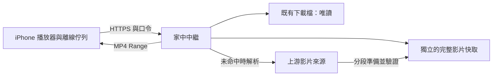

# 家中中繼（0.17.0／build 57）

本版實測範圍、發現的問題與限制見 [驗證紀錄](HOME-RELAY-TESTING.md)。

這是可選的媒體傳輸模式。App 的帳號、收藏與觀看紀錄仍由原本流程處理。
設定 → 播放方式 → 家中中繼，輸入 HTTPS 網址及私人口令，選擇「伺服器已存劇集」
或「內建目錄」，按連線驗證後才會切換。口令儲存在 Keychain，不放進 Git 或 IPA。
切回「內建播放」即可停用中繼。

已下載片庫優先，其次完整快取，最後才重新取源。開始串流時同步填入獨立快取，
並預先準備下一集。舊下載器已解密但殘留輔助加密標記的檔案，會在傳輸時整理已確認為未加密軌道的檔頭；原檔與樣本資料不變，真正的加密軌道仍拒絕直接當成未加密影片。每個來源版本有獨立的媒體網址，失敗後重新解析不會混用舊版位元組。
健康的來源與已完成檔案會重用，避免 refresh 造成重複下載。既有下載器的檔案、
任務與帳號狀態完全不由此服務修改。

中繼媒體傳輸遇到暫時斷線／503，可最多四次延遲重試，從已收到的位元組接續；有前綴資料時必須核對相同 ETag 與總長度。取消與關閉播放器會取消待重試工作。

「中繼無法連線時使用手機取源」預設開啟；暫時連線／伺服器故障可走手機備援。
401、403、無效網址及取消不會觸發備援。測試中可關閉此選項，確認沒有悄悄切回手機。
中繼傳輸仍可遇到家庭上傳頻寬不足、漫遊延遲或斷線，不保證東京網路與家中測試同速。

## 部署

使用 Node.js 24 LTS，於 `Backend` 執行 `npm run setup`，啟動
`node server/relay-index.mjs`。依既有下載器的 jobs.json 格式讀取已完成任務；不依賴
下載器登入介面，也不把原下載器網址誤當本服務。

| 環境變數 | 用途 |
|---|---|
| `RELAY_TOKEN_FILE` | 只允許服務帳號讀取的長隨機口令檔，至少 32 字元 |
| `RELAY_HOST` / `RELAY_PORT` | 綁定位址／埠，預設 127.0.0.1:8940 |
| `RELAY_LIBRARY_JOBS` | 既有下載器 data/jobs.json |
| `RELAY_LIBRARY_ROOT` | 既有下載影片根目錄 |
| `RELAY_CACHE_ROOT` | 專用可寫快取目錄，必須與原片庫分開 |
| `RELAY_CACHE_BYTES` | 快取上限，預設 2 GiB；另保留 512 MiB 磁碟餘量 |
| `RELAY_PROBE_SERIES` / `RELAY_PROBE_EPISODE` | 可選，自檢固定劇集／分集 ID |

反向代理需 HTTPS、保留 Authorization 與 Range，關閉回應緩衝，不加瀏覽器 SSO 轉址。
所有介面皆驗證 Bearer 口令。不要把服務設成無口令的公開解析器。
服務只接受分集 ID；上游跳轉與 CDN 主機經驗證，不提供任意 URL 代理。
登入用 Cookie、來源金鑰及含簽名的上游網址不寫入日誌。

建議用獨立 PM2 名稱管理，只 restart 此服務；部署前後核對原下載器 PID 與狀態檔。
快取可重建，原片庫與私人口令需獨立備份。停用時切回 App 內建播放，再停此 PM2
程序與專用反向代理即可；不需更動原下載器。

## API 與自檢

- `GET /health`：協定版本、能力、片庫／快取統計與最後自檢結果。
- `GET /api/home`、`/api/search?q=...`：已完成的伺服器片庫。
- `GET /api/series/{id}`：已存片庫的可用集數，或上游劇集資料。
- `GET /api/episodes/{id}/play?series_id=...&fresh=1`：驗證分集歸屬並回傳同站媒體路徑。
- `GET/HEAD /api/media/{version}.mp4`：完整／Range 206、ETag、If-Range、416。
- `GET /api/status`：請求、命中、位元組與錯誤計數，不含憑證。

啟動與每 15 分鐘執行一次自檢。有指定 probe 時繞過本機快取，實際解析上游並驗證
MP4 開頭；沒指定則驗證既有片庫。`passed` 代表取源及片段檢查，**不代表完整影音解碼**。
暫時分段失敗可有限重試；失敗的快取不會發布。重啟會清理本服務未完成／孤立快取。
未知協定變更仍需更新伺服器程式；服務不會自行抓任意程式碼並執行。

## 模擬器驗證

`swift test --disable-xctest` 與 `node --test Backend/tests/*.test.mjs` 跑核心測試。
`python3 scripts/home-relay-qa.py --device <Simulator UUID> --config <私有 JSON>`
建立隔離測試 App，使用真正的 PlayerModel 與伺服器。JSON 欄位是 baseURL、token、seriesID，
請存於 ignored build/ 並設 0600。`--case controls/offline/offline-reopen` 分別測試操作、
批次下載與重開後只用本機檔播放；`--episodes 1 33` 指定範圍。
`--reuse <evidence directory>` 可用同一個已建置版本繼續測試；`--rebuild` 更新來源與雜湊。
預設結束會關閉模擬器。證據與來源 SHA256 保留於 ignored build/，不公開口令。

`scripts/relay-fault-proxy.mjs <HTTPS relay origin> [port]` 僅綁定本機，
可在第一段影片傳輸達 256 KiB 後斷開並模擬 8 秒不可達，再恢復原中繼。
這是指定播放路徑的故障注入，並非關閉 Mac 所有網路。
